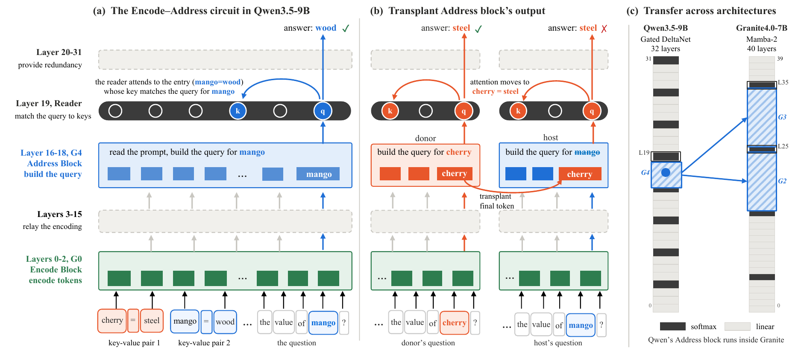

# LinearQuery

**Who Asks, Who Answers: Linear Attention Builds the Query in Hybrid Language Models**

Wenqi Zeng, Chen Feng, YuAng Chen · [arXiv:2611.01909](https://arxiv.org/abs/2611.01909)

Hybrid language models interleave many linear-attention layers with a few softmax-attention layers.
Softmax attention is usually credited with in-context retrieval, and linear attention is seen as a way
to compress past context. This project shows that linear attention plays a direct role in retrieval:
it builds the query that softmax attention uses for the lookup.



## Key findings

We study Qwen3.5 (Gated DeltaNet) and Granite4.0 (Mamba-2) on a controlled key-value retrieval task,
using only forward hooks on frozen public checkpoints.

- **Encode-Address circuit.** An early Encode block preserves token identity. An Address block builds the
  final-position representation from which a softmax *reader* forms its attention query.
- **The Address block decides what is retrieved.** Transplanting its output between prompts with different
  queried keys redirects retrieval in 0.97-0.98 of cases in Qwen3.5-9B. Its recurrent state carries the
  retrieval target.
- **The computation transfers across architectures.** Replacing Granite's Address block with Qwen's restores
  retrieval accuracy to 0.92-0.94, without updating either model's weights.
- **Address computation changes with scale.** Up to 9B, one Address block guides all the readers. In
  Qwen3.5-27B and 35B-A3B, several blocks work jointly, each guiding its own readers.

## Getting started

```bash
git clone https://github.com/Wendysigh/LinearQuery.git
cd LinearQuery
python -m venv .venv && source .venv/bin/activate
pip install -r requirements.txt
pip install --no-build-isolation mamba-ssm==2.3.2.post1    # its build needs torch installed first
```

Transplant every linear block of the smallest model, one block at a time (about a minute on a GPU;
the checkpoint downloads on first use):

```bash
python -m experiments.transplant --model 0.8B --format chat8
```

Only the Address block `G3` redirects retrieval:

```
  G2 final  ansA 0.00  ansB 1.00  attA 0.01
  G3 final  ansA 0.99  ansB 0.01  attA 0.84
  G4 final  ansA 0.00  ansB 1.00  attA 0.00
```

`ansA` is how often the host answers the donor's question, and `attA` is the reader's attention on the
donor's entry.

## Experiments

| Script (`python -m experiments.<name>`) | Question |
|---|---|
| `truncation`, `knowledge` | Where along the network does retrieval appear, compared with knowledge? |
| `scan` | Which blocks and layers are necessary, and which softmax heads are the readers? |
| `remove_blocks` | What happens when all Address blocks are removed jointly? |
| `transplant` | Which block's output is sufficient to redirect retrieval? |
| `construction` | Does the Address block set the query or the keys, and what carries the target? |
| `encode_swap`, `encode_replace` | What does the Encode block contribute? |
| `transfer_output`, `transfer_block` | Does the Address block work in another architecture? |

Models and their Address blocks are listed in [`configs/models.yaml`](configs/models.yaml):
Qwen3.5 0.8B, 2B, 4B, 9B, 27B and 35B-A3B, and Granite4.0 1B and 7B.

## Reproducing the paper

Every figure and table can be rebuilt from the saved results in `results/` without a GPU, or rerun from
scratch. See [REPRODUCE.md](REPRODUCE.md).

## Repository layout

```
configs/models.yaml   model tags, Address blocks and tracked reader heads
linquery/             task prompts, model runner, hooks, stitching maps, evaluators
experiments/          one script per intervention
results/              the JSON output behind the paper
reproduce.py          run the experiments for a paper item on a pool of GPUs
make_figures.py       build the figures from results/
make_tables.py        print the tables and in-text numbers from results/
```

## Citation

```bibtex
@misc{zeng2026whoasks,
  title  = {Who Asks, Who Answers: Linear Attention Builds the Query in Hybrid Language Models},
  author = {Zeng, Wenqi and Feng, Chen and Chen, YuAng},
  year   = {2026},
  eprint = {2611.01909},
  archivePrefix = {arXiv},
  primaryClass  = {cs.AI},
  url    = {https://arxiv.org/abs/2611.01909}
}
```

## License

[MIT](LICENSE)
